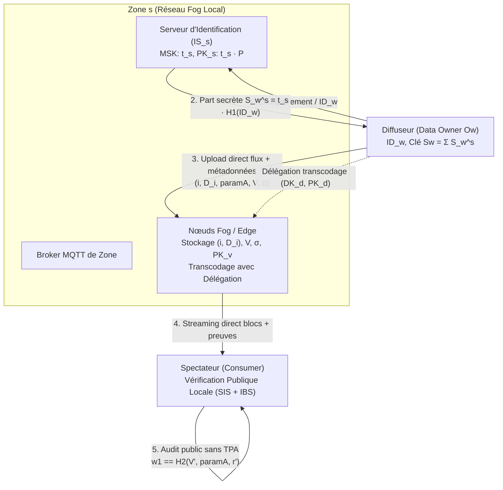
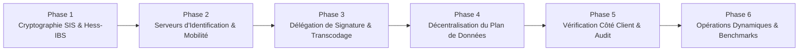

# Plan d'Implémentation : Mise en Conformité du Projet Pledge avec l'Article Scientifique

Ce document formalise la feuille de route technique pour aligner l'architecture et le code du projet **Pledge** avec l'article scientifique de référence :  
> **"A verifiable data integrity scheme for distributed data sharing in fog computing architecture"**  
> *Youssef Sellami, Youcef Imine, Antoine Gallais (Future Generation Computer Systems 150, 2024, pp. 64–77).*

---

## 1. Diagnostic de Conformité et Matrice des Écarts

| Composant / Fonctionnalité | Spécification de l'Article (FGCS 2024) | État Actuel du Projet Pledge | Statut |
| :--- | :--- | :--- | :---: |
| **Auditabilité publique sans TPA** | Tout client final (viewer) vérifie directement l'intégrité sans tiers ni serveur central. | Le spectateur ne vérifie rien ; le backend central interroge le serveur crypto en tâche de fond. | ❌ Non conforme |
| **Topologie & Décentralisation** | Entièrement décentralisée par zones, flux directs clients ↔ nœuds Fog. | Décentralisée : FastAPI limité à la signalisation/annuaire, flux directs P2P Streamer/Viewer ↔ Fog. | ✅ Conforme (Phase 4) |
| **Générateur SIS ($param_A$)** | Générateur LCG/MWC de L'Ecuyer ($I_{n+1} = (aI_n + C_n) \bmod q$) avec stockage $O(1)$. | `np.random.default_rng(42)` (NumPy PCG64), non conforme aux équations du papier. | ⚠️ Partiel / Non conforme |
| **Construction du vecteur $x_i$ (SIS)** | Répétition de la séquence binaire $h_i \in \{0, 1\}^\lambda$ pour obtenir $x_i \in \{0, 1\}^m$. | Répétition de la chaîne d'octets SHA-256 (valeurs 0..255 et non bits 0..1). | ❌ Non conforme |
| **Schéma de Signature (Hess-IBS)** | Signature basée sur l'identité de l'owner ($ID_w$) sur courbe avec pairing ($e: G_0 \times G_0 \to G_1$). | Identité ignorée. Faille critique : `secret_share = public_key` (signature sans secret réel). | ❌ Faille critique |
| **Serveurs d'Identification ($IS_s$)** | $IS_s$ par zone générant $MSK_s = t_s$, distribuant la part $S_w^s = t_s \cdot H_1(ID_w)$. | Inexistant. Le serveur crypto n'est qu'un microservice de calcul sans gestion d'identités. | ❌ Non conforme |
| **Mobilité multi-zone** | Accumulation de parts secrètes $S_w \leftarrow \sum S_w^s$ et clés publiques $PK \leftarrow \sum PK_s$. | Inexistant. Zones statiques hardcodées dans le backend web. | ❌ Non conforme |
| **Délégation de signature** | Clé de délégation $DK_d = S_w + y \cdot H_1(ID_d)$ permettant au Fog de transcoder légitimement. | Implémentée : émission $DK_d$, worker transcodage Edge $D_i \to D'_i$, signature $\sigma_1$, et vérification à 3 accouplements bilinéaires. | ✅ Conforme (Phase 3) |
| **Opérations dynamiques** | Suppression, modification et insertion directes sur la matrice $V$ sans recalculer $A$. | Inexistant. Simple stockage de fichiers `.dat` séquentiels sans structure matricielle globale. | ❌ Non conforme |

---

## 2. Architecture Cible Conforme



---

## 3. Découpage du Plan de Réalisation



---

### Phase 1 : Refonte Cryptographique du Moteur SIS et de la Signature Hess-IBS

> **Objectif :** Remplacer le mock cryptographique actuel par les équations exactes de l'article dans `serveur_crypto/crypto_node.py` et fournir une bibliothèque partagée.

#### Tâches techniques :
1. **Générateur uniforme $I$ selon L'Ecuyer (1994) :**
   - Implémenter le générateur récursif :
     $$I_{n+1} = (a \cdot I_n + C_n) \bmod q, \quad C_{n+1} = \lfloor(a \cdot I_n + C_n) / q\rfloor$$
   - Définir `paramA` comme le triplet $(I_0, a, C_0)$ garantissant la reconstruction déterministe de la matrice $A \in \mathbb{Z}_q^{l \times m}$ en mémoire sans surcoût de transfert ($O(1)$ métadonnées).
2. **Construction binaire stricte de $X$ et calcul de $V$ :**
   - Transformer $H_3(D_i)$ en séquence de bits $\{0, 1\}^\lambda$ (avec $\lambda = 256$ pour SHA-256).
   - Répéter le vecteur de bits $m/\lambda$ fois (ex: $1536 / 256 = 6$ fois) pour obtenir $x_i \in \{0, 1\}^m$.
   - Calculer la colonne $v_i = A \cdot x_i \bmod q$ avec les paramètres $l=64, m=1536, q=4099$.
   - Agréger les colonnes pour former la matrice $V = [v_1, \dots, v_N] \in \mathbb{Z}_q^{l \times N}$.
3. **Implémentation stricte de Hess-IBS (sur courbe BN128/Alt-bn128) :**
   - Fonction $H_1: \{0, 1\}^* \to G_0$ : implémenter un hachage vers la courbe elliptique (*Hash-to-Curve* sur $G_1$ de BN128 via Map-to-Curve déterministe ou Try-and-Increment).
   - Fonction $H_2(V, param_A, r) \to \mathbb{Z}_p^*$ : hachage cryptographique SHA-256 sérialisant la matrice $V$, les paramètres de $A$, et l'élément de couplage $r \in G_1$.
   - **Correction de la faille de clé :**
     - Supprimer l'affectation `secret_share = public_key`.
     - Générer la signature avec la vraie part secrète $S_w \in G_0$ :
       $$r = e(P, P_1)^k, \quad w_1 = H_2(V, param_A, r), \quad w_2 = w_1 \cdot S_w + k \cdot P_1$$
     - Valider la vérification par couplage :
       $$r' = e(w_2, P) \cdot e(H_1(ID_w), -PK)^{w_1}, \quad w_1 \stackrel{?}{=} H_2(V', param_A, r')$$

---

### Phase 2 : Serveurs d'Identification ($IS_s$) et Gestion de la Mobilité Multi-Zone

> **Objectif :** Transformer le conteneur crypto en véritable Serveur d'Identification ($IS_s$) capable de gérer les zones et d'émettre des clés d'identité sans autorité centrale.

#### Tâches techniques :
1. **Module Setup d'une Zone :**
   - Chaque zone $s$ instancie son serveur d'identification avec son secret maître $MSK_s = t_s \in \mathbb{Z}_p^*$.
   - Publication du paramètre public de zone : $PK_s = t_s \cdot P$.
2. **Protocole d'identification de l'Owner ($O_w$) :**
   - Endpoint `POST /api/v1/auth/identify` :
     - Reçoit $ID_w$ (email ou identifiant unique de l'utilisateur).
     - Calcule la part secrète $S_w^s = t_s \cdot H_1(ID_w) \in G_0$.
     - Transmet $S_w^s$ à l'utilisateur via canal chiffré (TLS).
3. **Gestion de la Mobilité (Transition $zone_1 \to zone_2$) :**
   - Côté client / diffuseur :
     - Initialisation : $S_w = S_w^1$, $PK = PK_1$.
     - Changement de zone : $S_w \leftarrow S_w + S_w^s$, $PK \leftarrow PK_v + PK_s$.
   - Permettre à l'utilisateur de signer des blocs avec sa clé agrégée multi-zone sans révoquer ses contenus précédents.

---

### Phase 3 : Délégation de Signature et Transcodage sur les Nœuds Edge ✅ [TERMINÉE]

> **Objectif :** Permettre aux nœuds Fog d'adapter la résolution vidéo à la volée tout en conservant la prouvabilité de l'intégrité (Section 3.6 de l'article).

#### Tâches techniques réalisées :
1. **Émission de la clé de délégation ($DK_d$, $PK_d$) :**
   - Implémenté dans `serveur_crypto/crypto_engine.py` (`generate_delegation_key`) et endpoint `POST /api/v1/crypto/delegation/issue`.
   - $y \in \mathbb{Z}_p^*$, $PK_d = y \cdot P$, $DK_d = S_w + y \cdot H_1(ID_d)$.
2. **Worker de Transcodage Edge avec Re-signature :**
   - Implémenté dans `broker_et_client/client_mqtt/edge_transcoder.py` (`EdgeTranscoder`) et intégré dans `broker_et_client/client_mqtt/client_edge.py`.
   - Adaptation/transcodage $D_i \to D'_i$ (profil 720p).
   - Recalcul de $x'_i$ et $v'_i = A \cdot x'_i \bmod q$.
   - Re-signature déléguée $\sigma_1 = (w_1, w_2)$ avec $DK_d$ selon la Section 3.6.2.
   - Enregistrement des blocs transcodés `bloc_{i}_720p.dat` et diffusion sur demande `quality=720p`.
3. **Vérification de la Signature Déléguée (3 accouplements) :**
   - Implémenté dans `crypto_engine.py` (`verify_delegated_signature`), `crypto_node.py` (`POST /api/v1/crypto/verify/delegate`), et `stream_router.py`.
   - Formule à 3 accouplements bilinéaires :
     $$r' = \frac{e(w_2, P) \cdot e(H_1(ID_w), -PK')^{w_1}}{e(PK_d, H_1(ID_d))^{w_1}}$$
   - Interface utilisateur dans `App.jsx` avec sélecteur de résolution (1080p / 720p Fog) et badge d'intégrité certifiant la signature déléguée.
4. **Validation par banc de tests automatisés :**
   - Tests unitaires et d'intégration validés à 100% dans `test_crypto_engine.py`, `test_crypto_node.py` et `test_edge_transcoder.py`.

---

### Phase 4 : Décentralisation du Plan de Données (Suppression du Goulot Central) ✅ [TERMINÉE]

> **Objectif :** Rétablir une architecture Fog pair-à-pair où les flux vidéo ne transitent plus par le backend FastAPI central.

#### Tâches techniques :
1. **Rôle réorienté du Backend Web :**
   - Le backend FastAPI se limite au **plan de découverte et d'annuaire** (Signalisation / Cordonnancement).
   - Il fournit au streamer l'URL WebSocket directe du nœud Edge sélectionné, et au viewer l'adresse directe du flux.
2. **Plan de données direct :**
   - Le diffuseur streame directement vers `ws://<edge_node_ip>:8444/upload/<session_id>`.
   - Le spectateur visionne directement depuis `ws://<edge_node_ip>:8444/download/<session_id>`.
   - Le paquet de transmission transporte la trame ainsi que les métadonnées de vérification :
     ```json
     {
       "block_index": 42,
       "payload_b64": "...",
       "paramA": {"I0": 1234, "a": 5678, "C0": 9012},
       "V_column": [12, 450, 2030, ...],
       "signature": {"w1": "...", "w2": ["...", "..."]},
       "signer_id": "alice@pledge.local",
       "is_delegated": false
     }
     ```

---

### Phase 5 : Vérification d'Intégrité Côté Spectateur (Audit Public sans TPA)

> **Objectif :** Implémenter la vérification locale dans le navigateur du spectateur, principe fondateur de l'article scientifique.

#### Tâches techniques :
1. **Module Cryptographique WebAssembly / TypeScript pour le Frontend :**
   - Intégrer une bibliothèque de couplage BN128 rapide dans le navigateur (ex: `@noble/curves` ou `mcl-wasm` compilé en WebAssembly).
   - Implémenter le calcul SIS local : hachage SHA-256 du chunk reçu, reconstruction matricielle de $A$, produit matriciel $A \cdot x'_i \bmod q = v'_i$.
   - Calculer le couplage bilinéaire et tester $w_1 \stackrel{?}{=} H_2(V', param_A, r')$.
2. **Interface Utilisateur Enrichie (Tableau de Bord d'Intégrité en Direct) :**
   - Remplacer le simple compteur de blocs par un badge d'intégrité dynamique :
     - 🟢 **Intègre** (Vérifié mathématiquement par SIS & Hess-IBS).
     - 🟡 **Transcodé légitime** (Signature déléguée vérifiée avec $PK_d$).
     - 🔴 **Altéré / Corrompu** (Échec du challenge mathématique, coupure immédiate).
   - Afficher les métriques de latence de vérification mesurées (temps de calcul local SIS vs temps de lecture).

---

### Phase 6 : Opérations Dynamiques et Validation Expérimentale

> **Objectif :** Implémenter les opérations dynamiques sur $V$ et reproduire les benchmarks de l'article (Figures 6 à 14).

#### Tâches techniques :
1. **Opérations Dynamiques sur la Matrice $V$ :**
   - **Suppression d'un bloc $D_i$ :** suppression de la colonne $v_i$, réindexation et recalcul de la signature $\sigma$ en $O(1)$.
   - **Modification d'un bloc $D_i \to D'_i$ :** remplacement direct de $v_i$ par $v'_i$ sans toucher aux autres colonnes.
   - **Insertion d'un bloc $D_{N+1}$ :** concaténation de la colonne $v_{N+1}$ et mise à jour de la signature.
2. **Suite de Tests et Validation Expérimentale :**
   - Écrire une suite de tests automatisés validant la non-falsification (résistance aux collisions SIS et à la forge de signature).
   - Mesurer le temps moyen de vérification par bloc pour vérifier qu'il s'aligne sur les résultats expérimentaux du papier ($\approx 0.42$ ms par bloc pour $l=64, m=1536$).

---

## 4. Priorisation et Effort Estimé

| Phase | Description | Priorité | Effort Estimé | Dépendances |
| :---: | :--- | :---: | :---: | :---: |
| **Phase 1** | Correction des failles cryptographiques (SIS L'Ecuyer, Hess-IBS, Hash-to-curve) | 🔴 Critique | 3 - 4 j | Aucune |
| **Phase 2** | Implémentation des serveurs $IS_s$ et de la mobilité multi-zone | 🟠 Haute | 2 - 3 j | Phase 1 |
| **Phase 4** | Décentralisation du plan de données (Flux P2P Fog sans goulot central) | 🟠 Haute | 2 j | Phase 1 |
| **Phase 5** | Vérification d'intégrité côté spectateur (WASM / Noble Curves) | 🟠 Haute | 3 j | Phase 1, Phase 4 |
| **Phase 3** | Délégation de signature et transcodage Edge | ✅ Terminée | 2 - 3 j | Phase 1, Phase 2 |
| **Phase 6** | Opérations dynamiques et banc de test / conformité papier | 🟢 Standard | 2 j | Toutes |

---

## 5. Recommandations Immédiates

1. **Assainir la signature dans `serveur_crypto/crypto_node.py`** en priorité absolue : éliminer la ligne `state.secret_share = state.public_key` et intégrer l'identité de l'émetteur dans le challenge.
2. **Déplacer la responsabilité du contrôle d'intégrité du backend FastAPI vers le client web**, afin de respecter la promesse d'auditabilité publique sans autorité centrale (*Public auditability without TPA*).
3. **Mettre en place un vrai protocole d'échange de clés de zone** entre le streamer et le serveur crypto plutôt que des scalaires partagés arbitraires dans les fichiers d'environnement.
